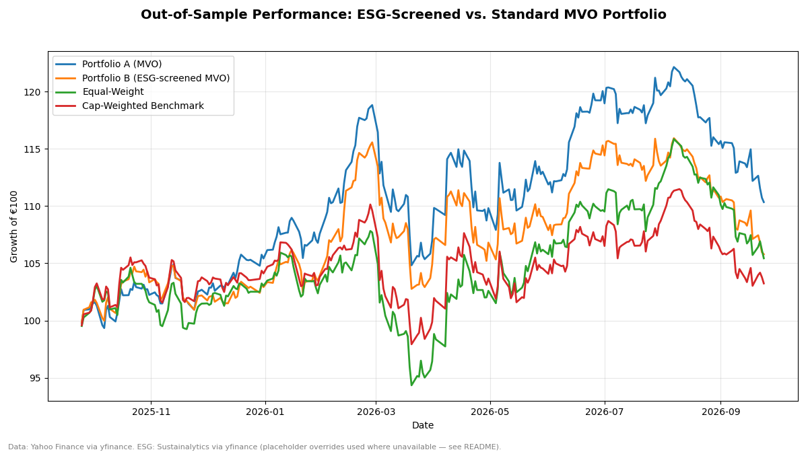

# ESG-Screened vs. Standard Mean-Variance Portfolios (SBF 120)

**TL;DR:** I built two optimized portfolios from 28 French large/mid-cap
stocks — one standard "max-Sharpe" portfolio, and one that first excludes the
25% highest-ESG-risk names before optimizing. Both were tuned on 2021–2025
data and then tested, untouched, on the most recent 12 months. In that one
out-of-sample year, the unscreened portfolio outperformed (+10.3% vs. +5.8%
cumulative), which is a reminder that a single test year proves very little —
see the limitations below before drawing conclusions.



## What this is

A small, fully reproducible research project comparing:

- **Portfolio A** — standard mean-variance optimization (max-Sharpe), no ESG input
- **Portfolio B** — the same optimizer, but the bottom quartile of names by
  ESG risk (the 25% *riskiest* names) is excluded before optimizing
- **Equal-Weight** — all 28 eligible names, equal weight
- **Cap-Weighted Benchmark** — the CAC 40 index (see "Benchmark" below for why)

against each other, on both the data used to build them (in-sample) and a
held-out final year they never saw (out-of-sample).

## The universe

25–30 SBF 120 constituents were hand-picked across 8 sectors (Consumer
Discretionary, Consumer Staples, Financials, Industrials, Materials, Health
Care, Information Technology, Communication Services) to keep the comparison
diversified rather than one sector's story. Sector labels are assigned by
hand in `esg_vs_mvo/config.py` rather than trusted to yfinance's own
(frequently missing) sector field for European tickers.

Every candidate is screened for at least 3 years of price history and no
more than 5% missing trading days; none were excluded on this run. The full
decision log is in [`outputs/universe.csv`](outputs/universe.csv).

## What "mean-variance optimization" means, in plain terms

Given a set of stocks, their historical returns, and how they move together
(the covariance matrix), the optimizer searches for the mix of weights that
gives the best return per unit of risk — the highest **Sharpe ratio**. It's
mechanical: it has no opinion about the businesses, only about the numbers.
We constrain it so it can't go all-in on one winner: no name above 20% of
the portfolio, no sector above 35%.

*(For the curious: we estimate the covariance matrix with Ledoit-Wolf
shrinkage rather than the raw sample covariance, because with only ~1,000
daily observations and 21–28 assets, the raw sample covariance is noisy and
tends to overstate diversification benefits.)*

## The ESG screen

`totalEsg`, the field yfinance exposes for ESG data, is Sustainalytics'
**ESG Risk Score** — importantly, this is a *risk* score, where **lower is
better**. Portfolio B drops the quartile of names with the *highest* risk
score before optimizing, not the lowest.

**Data availability problem, disclosed rather than hidden:** at the time
this was run, yfinance's `sustainability` field returned empty for every
single ticker in the universe (0/28) — Yahoo appears to have quietly retired
or broken this endpoint. The pipeline is built to handle this honestly:

1. It tries yfinance for every name and logs the outcome.
2. If live coverage is below 70%, it falls back to a manual override file,
   [`data/esg_manual.csv`](data/esg_manual.csv).
3. **The scores currently in that file are illustrative placeholders**,
   clearly labeled as such in the file's own `source` column — they are
   *not* real Sustainalytics data. They exist so the pipeline can be
   demonstrated end-to-end. Anyone using this for real decisions needs to
   replace that file with a licensed ESG data feed (Sustainalytics, MSCI
   ESG, Refinitiv, etc.) or a working live API.
4. Full per-name coverage and status is written to
   [`outputs/esg_coverage.csv`](outputs/esg_coverage.csv) so nothing is
   dropped or substituted silently.

## The out-of-sample split — and why it matters

Both optimizers are estimated using **only the first 4 years** of the
5-year window (returns, volatility, covariance — all of it). The resulting
weights are then frozen and simply held, untouched, through **year 5**. The
optimizer never sees year-5 data before those weights are fixed.

This matters because it's very easy to build a backtest that looks great
by fitting a portfolio to data it's then "tested" on — that's not a test,
it's memorization. Locking the weights before the test period is the
minimum bar for a result to mean anything at all, and even then, one year
of out-of-sample data is a single roll of the dice, not a robust finding.

## Benchmark note

The `^SBF120` index series is not available through yfinance in this
environment (delisted/unsupported), so the cap-weighted benchmark uses the
**CAC 40 (`^FCHI`)** as a liquid, widely available proxy instead. If a real
SBF 120 series becomes available, swap the ticker in
`esg_vs_mvo/config.py` (`SBF120_TICKER_CANDIDATES`). If no index series is
available at all, the code falls back further to building a cap-weighted
line from the universe's own current market caps — that fallback was not
needed on this run.

## Results

See [`outputs/performance_table.md`](outputs/performance_table.md) for the
full table (in-sample and out-of-sample, all 4 lines, 7 metrics). Headline
out-of-sample numbers from the most recent run:

| Line | Cumulative Return | Ann. Return | Ann. Vol | Sharpe | Max Drawdown |
|---|---|---|---|---|---|
| Portfolio A (MVO) | 10.3% | 10.2% | 15.1% | 0.52 | -11.8% |
| Portfolio B (ESG-screened MVO) | 5.8% | 5.7% | 14.1% | 0.25 | -11.1% |
| Equal-Weight | 5.4% | 5.4% | 14.7% | 0.23 | -12.5% |
| Cap-Weighted Benchmark (CAC 40) | 3.2% | 3.2% | 13.9% | 0.08 | -11.1% |

**Read this carefully, not triumphantly.** The unscreened portfolio (A) beat
the ESG-screened one (B) here — B had slightly lower volatility and a
shallower drawdown, but also lower return and a lower Sharpe ratio. That's
one plausible outcome, not a verdict on ESG investing: excluding 7 of 28
names removed diversification, and the ESG scores driving that exclusion are
the placeholder values described above, not real ratings. Swap in real ESG
data and rerun before treating this as evidence of anything.

Charts:
- [`outputs/cumulative_returns.png`](outputs/cumulative_returns.png) — growth of €100, out-of-sample, all 4 lines
- [`outputs/drawdowns.png`](outputs/drawdowns.png) — underwater chart, out-of-sample
- [`outputs/weights.png`](outputs/weights.png) / [`weights.csv`](outputs/weights.csv) — per-name weights, A vs. B
- [`outputs/sector_exposure.png`](outputs/sector_exposure.png) — sector tilts of both portfolios vs. both benchmarks

## Limitations (read before sharing results further)

- **Look-ahead bias in the ESG screen itself:** even with real ESG data,
  today's ESG score would be applied to a portfolio built on the past — a
  company's *current* rating isn't what it was 4 years ago. A rigorous
  version would need historical ESG scores, which are rarely free.
- **The ESG scores used here are illustrative placeholders**, not licensed
  data (see above). Treat every ESG-related conclusion as a demonstration
  of methodology, not a real finding.
- **Survivorship bias:** the universe is today's SBF 120 members, so
  companies that were removed, merged, or delisted over the 5-year window
  aren't represented — real historical index membership would avoid this.
- **No transaction costs, taxes, dividend withholding, or rebalancing:**
  both portfolios are pure buy-and-hold after the single in-sample fit, and
  none of the frictions of actually trading this are modeled.
- **Mean-variance optimization is notoriously sensitive to the input
  expected returns.** Small changes in the estimation window or method can
  swing the "optimal" weights a lot; that instability is real and not fully
  visible in a single backtest.
- **One out-of-sample year is one data point.** Nothing here should be read
  as "ESG screening helps" or "ESG screening hurts" returns in general.

## Reproducing this

```bash
python3.12 -m venv .venv
source .venv/bin/activate
pip install -r requirements.txt

python -m esg_vs_mvo.main            # uses cached prices if present
python -m esg_vs_mvo.main --refresh  # forces a fresh download

pytest tests/ -q                     # unit tests for the metrics module
```

All outputs are written to `./outputs/`. `./outputs/run_log.txt` records the
exact parameters, universe decisions, and warnings for that run.

## Project structure

```
esg_vs_mvo/
  config.py     # universe, sectors, dates, constraints, risk-free rate
  data.py       # download, caching, screening, ESG resolution
  optimize.py   # covariance estimation, constrained max-Sharpe optimizer
  backtest.py   # in/out-of-sample split, portfolio + benchmark construction
  metrics.py    # performance statistics
  plots.py      # chart generation
  main.py       # pipeline entry point
tests/
  test_metrics.py
data/
  esg_manual.csv     # manual ESG override (currently placeholder data)
  prices.parquet      # cached price download (generated on first run)
outputs/               # all generated tables, charts, and logs
```

---
*Educational project only. Not investment advice. Past performance, backtested
or otherwise, does not predict future results.*
